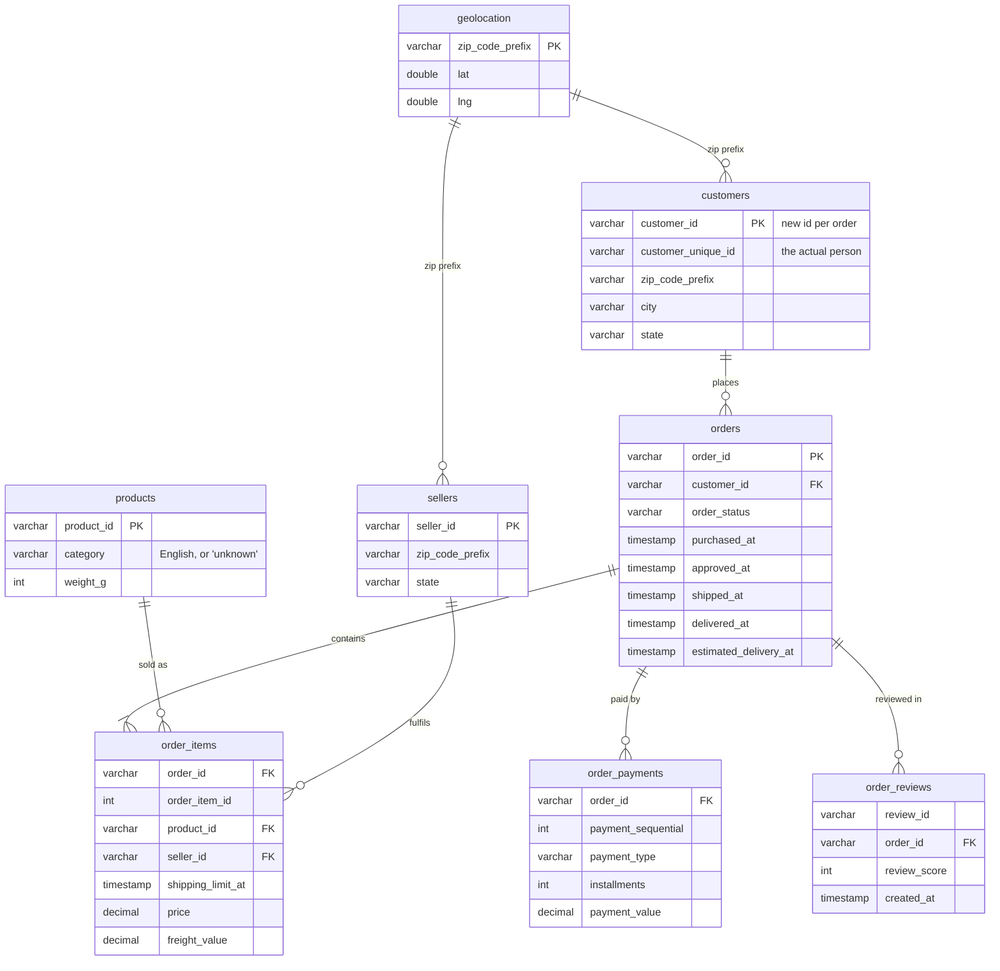

# Data model

Source: [Olist Brazilian E-commerce Public Dataset](https://www.kaggle.com/datasets/olistbr/brazilian-ecommerce)
(about 100k orders placed on the Olist marketplace, 2016–2018, licensed CC BY-NC-SA 4.0).

## Staging layer (`stg.*`)

## Design decisions

| Decision | Why |
|---|---|
| Raw layer loads every column as `VARCHAR` | Nothing is silently mis-typed on load; all casting is explicit and reviewable in `sql/staging/`. |
| `TRY_CAST` in staging | Bad values become `NULL` (and show up in the data-quality report) instead of failing the whole load. |
| Zip prefixes stay `VARCHAR` | Casting to integer would drop leading zeros (`01001` → `1001`) and break joins. |
| `stg.geolocation` aggregated to one row per prefix | The raw table has many rows per prefix; joining it directly would multiply rows. |
| Staging objects are views | The dataset is small enough for DuckDB to recompute them instantly, and views keep one source of truth. |
| Column renames (`*_lenght` → `*_length`, `order_delivered_customer_date` → `delivered_at`) | Fixes source typos and makes the SQL easier to read. |
